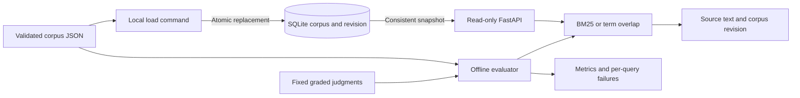

# TraceFind

TraceFind searches a small support handbook and measures how well its results match fixed relevance judgments. It pairs a read-only FastAPI service with atomic SQLite corpus replacement, an explainable BM25 ranker, a term-overlap baseline, and an offline evaluation that exposes failures.

[CI results](https://github.com/Mzulhaq/tracefind/actions/workflows/ci.yml) · [Measured evaluation](docs/evaluation.md) · [Interview guide](docs/interview-guide.md)

It runs locally without API keys, model downloads, or paid services. This is real lexical retrieval, a component of document search and RAG systems. It does not use embeddings or an LLM and does not generate answers.

## Run it

Requires Python 3.11 or later. From this repository:

```powershell
python -m venv .venv
.\.venv\Scripts\Activate.ps1
python -m pip install -r requirements.lock
python -m pip install --no-deps -e .
python scripts/demo.py
```

On Linux/macOS, activate with `source .venv/bin/activate` instead. The demo creates a temporary database, starts a real loopback HTTP server on an available port, verifies API/offline ranking agreement and exact source citations, evaluates the fixed dataset, and cleans up. All documents and queries are fictional, original synthetic data.

To keep a database and explore the API:

```bash
tracefind --db tracefind.db load data/corpus.json
tracefind --db tracefind.db search "recover authenticator access" --k 3
tracefind --db tracefind.db serve
```

Open `http://127.0.0.1:8000/docs` for interactive API documentation. An example request is `GET /v1/search?q=password%20reset&k=3&method=bm25`. Use `method=overlap` to compare the baseline. `/health` is a liveness check; `/v1/corpus` reports revision and document count. An empty corpus produces HTTP 409 on search, invalid query parameters produce 422, and a database read failure produces a generic 503. There are no HTTP write endpoints.

The `source` field is an opaque citation label such as `handbook://access/reset-password`. It is never fetched. Each search hit contains the full original body as `text`, its title, ID, source, and score, alongside the corpus revision. Scores order results; they are not answer confidence or probabilities.

## Architecture and decisions



The corpus revision is a SHA256 of canonical documents sorted by ID. Reordering identical input leaves the revision unchanged. SQLite commits all documents and the revision together; each search reads them in one transaction. Ranking uses that in-process snapshot, even if a subsequent load replaces the database. The service does not keep a cache that can outlive its revision.

To avoid overwriting a concurrent operator's update, supply the revision you inspected:

```bash
tracefind --db tracefind.db load data/corpus.json --expected-revision YOUR_CURRENT_SHA256
```

The comparison happens under the write transaction before checking whether content is unchanged. A stale revision exits 2. Without that option, replacement is unconditional. Revisions identify content, not a monotonic edit sequence; only the current corpus is retained. Other CLI validation/operational errors exit 1. Argparse usage errors also exit 2.

The tokenizer applies Unicode NFKC and casefolding and splits into letter/digit runs. Query terms are unique. Both rankers use title plus body without a title boost. BM25 uses `k1=1.2`, `b=0.75`, term-frequency saturation, document-length normalization, and positive inverse document frequency. The baseline counts distinct query terms present in a document. Results with zero score are excluded; ties use document ID. The [Lucene BM25 reference](https://lucene.apache.org/core/10_5_2/core/org/apache/lucene/search/similarities/BM25Similarity.html) documents the IDF variant and parameter defaults; this repository implements the formula directly in Python.

## Reproduce the evaluation

```bash
tracefind evaluate --corpus data/corpus.json --queries data/queries.json --k 3
python scripts/check_evaluation.py
```

The dataset contains 20 runbooks and 24 queries: 20 answerable cases with grades 1–3 and four unanswerable cases. Labels were frozen before scoring. Answerable cases contribute to macro recall@k, MRR@k, and graded nDCG@k. Unanswerable cases are excluded from those averages and report empty-result rate and false-positive count separately. Invalid labels, unknown document IDs, duplicate case IDs, and invalid grades fail validation.

[Full evaluation](docs/evaluation.json) records corpus/query hashes, ranking policy, both methods, per-query results, and failures. [Evaluation notes](docs/evaluation.md) discuss actual scores and errors. The check script compares the stored report with a fresh calculation, allowing only `1e-12` numeric variation; it does not rewrite the evidence or demand that BM25 beat the baseline.

This is a small AI-authored synthetic set with no independent human judgments or held-out split. Its results demonstrate evaluation mechanics, not generalization or production performance. Common words can retrieve unrelated documents, and lexical overlap cannot determine whether a question is answerable. No stemming, stopword filtering, synonym expansion, semantic reranking, or abstention classifier is included.

## Development and Docker

```bash
python -m pytest --cov=tracefind --cov-report=term-missing
python -m ruff check .
python -m ruff format --check .
python -m build
python -m pip check
docker build -t tracefind .
docker run --rm --network none tracefind
```

The container runs the real HTTP demo as a non-root user; its requests use loopback with proxy discovery disabled. `requirements-runtime.lock` pins runtime dependencies, while `requirements.lock` adds development tools. [Verification evidence](docs/validation.md) distinguishes local checks from remote CI, including Windows/Linux and Python 3.11/3.13.

## Limits and extension points

Each JSON input is capped at 2 MiB. A corpus contains 1–500 unique documents and at most 1,000,000 total field characters. Documents require exactly `id`, `title`, `body`, `source`; limits are 64/160/8000/200 characters respectively, with ASCII identifiers and nonblank text. Queries are at most 512 characters and `k` is 1–20. Duplicate JSON object keys and nonfinite JSON numbers are rejected. No environment file is needed; the CLI options above are the example configuration.

Ranking rebuilds token statistics per request and scans the bounded corpus. This makes the reference implementation easy to inspect but is unsuitable for large collections. A larger system would need an inverted index, explicit access controls, operational monitoring, and a broader evaluated dataset. SQLite is local and unencrypted, and the API has no authentication or rate limiting; it binds to loopback by default. Use the supplied synthetic data for the demo. No production deployment, throughput, latency target, or business impact is claimed.

## Learning and provenance

See the [interview guide](docs/interview-guide.md) for architecture questions, answer notes, two draft resume bullets, and a small exercise adding frozen paraphrase cases. [Career references](docs/career-fit.md) connect these skills to actual employer postings without promising job eligibility or outcomes.

AI coding assistance designed, implemented, tested, and reviewed this project and authored the synthetic dataset. Review the code, run the demo, and make your own change before adapting the resume drafts to your actual contribution. All original code and data are covered by the [MIT license](LICENSE); no private data or third-party handbook text is included.
